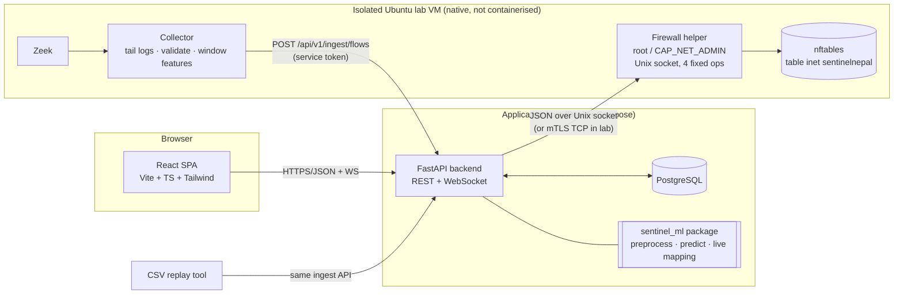
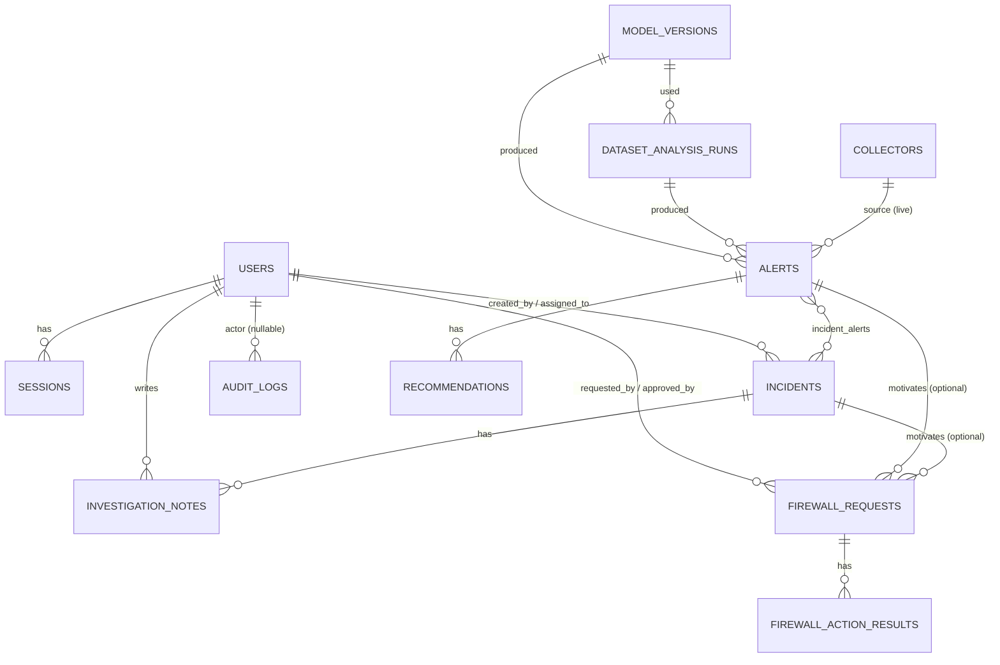
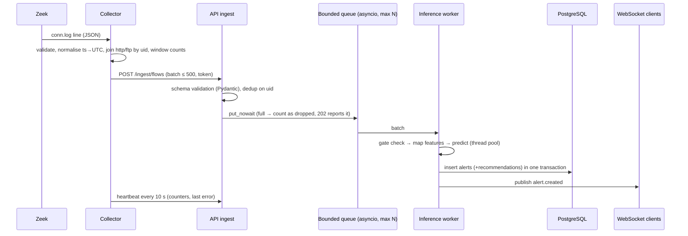
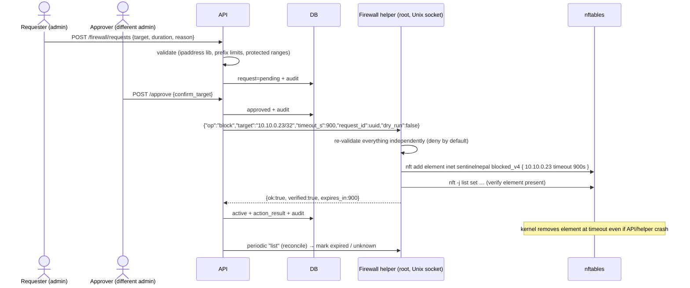
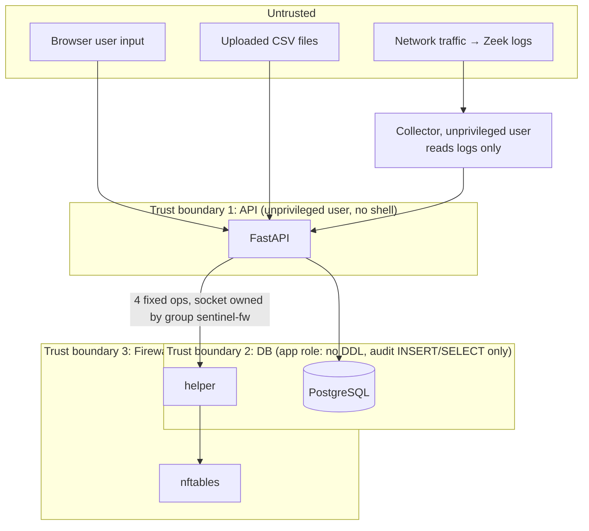

# SentinelNepal — System Architecture

> Status: **Phase 0 draft — awaiting approval.** Nothing described here is implemented yet.
> Diagrams use Mermaid (rendered by GitHub).

## 1. Purpose and scope

SentinelNepal is a machine-learning-assisted network intrusion detection and incident
response platform built as a Tribhuvan University BSc CSIT final-year project. It:

1. Scores network flow records (uploaded datasets, CSV replay, or Zeek metadata from an
   authorised lab) with a trained classifier and raises **alerts** — not verdicts.
2. Helps analysts investigate alerts, group them into **incidents**, and record notes.
3. Suggests **rule-based defensive recommendations** per alert category.
4. Lets an **administrator approve** a temporary, reversible IP/CIDR block applied by a
   narrowly privileged nftables helper in an isolated Ubuntu lab.
5. Records every security-relevant action in an append-only **audit log**.

Out of scope: production deployment, internet-facing operation, automatic blocking,
deep packet inspection written from scratch, threat-intelligence feeds, geolocation,
attribution of attackers.

## 2. Guiding principles

| Principle | Consequence in the design |
|---|---|
| A model score is evidence, not proof | Alerts are always "suspected"; incidents start as `new`; UI wording says "predicted" |
| Scores are not probabilities | Stored and shown as an *uncalibrated model score* unless Phase 2 calibration testing justifies otherwise |
| Humans decide on response | No code path from prediction → firewall without an approved request by an admin |
| Least privilege | Web API never runs as root; firewall helper exposes 4 fixed operations over a local socket |
| Honest failure | If the model, collector, or helper is unavailable, the UI shows "unavailable" — never placeholder data |
| One implementation per rule | Feature engineering lives only in the `sentinel_ml` package; the API and collector import it |
| Small and finishable | No message brokers, no Kubernetes, no microservice sprawl; one API process + one collector + one helper |

## 3. High-level component view



Notes:

* The **collector** and **firewall helper** run natively on the lab VM because they need
  network-interface access and `CAP_NET_ADMIN`. In the simplest lab layout the backend
  also runs on that VM so the helper can listen on a Unix socket only.
* **CSV replay** uses the *same* ingest endpoint as the collector, so the live pipeline can
  be demonstrated and tested without Zeek.
* The ML package is imported in-process by the API (no separate model server): a
  scikit-learn Random Forest predicts a batch of records in milliseconds, so a network hop
  would add complexity without benefit.

## 4. Module breakdown

| # | Module | Location | Responsibility |
|---|---|---|---|
| 1 | Frontend dashboard | `frontend/` | SPA pages, typed API client, route guards (UX only — backend enforces) |
| 2 | Authentication & authorisation | `backend/app/core/security.py`, `api/v1/auth.py` | Argon2 password hashing, server-side sessions, role dependencies (`admin`, `analyst`) |
| 3 | Dataset ingestion | `backend/app/services/datasets.py` | Upload limits, CSV sniffing, schema detection, chunked reading, run bookkeeping |
| 4 | Feature normalisation | `ml/sentinel_ml/features/` | Column aliasing, type coercion, dataset-schema → canonical features, live FlowRecord → canonical features, availability matrix |
| 5 | Model training & evaluation | `ml/sentinel_ml/training/`, `ml/sentinel_ml/evaluation/` | Offline CLI; produces versioned artifact + JSON/Markdown reports |
| 6 | Prediction service | `ml/sentinel_ml/inference/` + `backend/app/services/ml_service.py` | Load approved artifact (hash-checked), validate, predict, explain (feature importance) |
| 7 | Alert management | `backend/app/services/alerts.py` | Persist predictions above threshold as alerts; severity heuristic; status changes |
| 8 | IP & subnet investigation | `backend/app/services/ip_investigation.py` | Queries on PostgreSQL `INET` columns: history per IP, `/24` and `/64` aggregation, ports/protocols |
| 9 | Recommendation engine | `backend/app/services/recommendations/` | Versioned rule table → recommendations with evidence, limitations, approval flag |
| 10 | Incident management | `backend/app/services/incidents.py` | Incident lifecycle, assignment, notes, alert linking |
| 11 | Audit logging | `backend/app/services/audit.py` | Append-only writes; DB trigger blocks UPDATE/DELETE |
| 12 | Live traffic collector | `collector/` | Tail Zeek `conn.log` (+ `http.log`, `ftp.log`), validate, compute window counts, batch-POST |
| 13 | Real-time event delivery | `backend/app/services/realtime.py` | In-process pub/sub → authenticated WebSocket `/api/v1/ws/events` |
| 14 | Firewall approval & response | `backend/app/services/firewall/` (client + workflow), `firewall/` (helper) | Request → approve → execute → verify → expire/revoke → reconcile |
| 15 | Reporting & system health | `backend/app/api/v1/health.py`, `reports.py` | Liveness/readiness, component status, summary exports |

## 5. Repository layout (target)

```
SentinelNepal/
├── AGENTS.md                     # persistent conventions for humans and coding agents
├── README.md
├── docker-compose.yml            # db, backend, frontend (collector/helper run natively)
├── .env.example
├── docs/
│   ├── implementation-plan.md
│   ├── architecture.md
│   ├── threat-model.md
│   ├── PROJECT_STATUS.md
│   └── (later) feature-mapping.md, firewall-safety.md, test-report.md, user-manual.md …
├── backend/
│   ├── app/
│   │   ├── main.py               # app factory, middleware, router registration
│   │   ├── api/v1/               # thin route modules (validation + auth + call service)
│   │   ├── core/                 # config, logging, errors, security, rate limiting
│   │   ├── db/                   # engine/session, declarative base
│   │   ├── models/               # SQLAlchemy ORM models
│   │   ├── schemas/              # Pydantic request/response models
│   │   ├── services/             # business logic (no FastAPI imports here)
│   │   └── workers/              # periodic tasks: firewall reconcile, analysis runner
│   ├── migrations/               # Alembic
│   ├── tests/
│   ├── pyproject.toml / requirements*.txt
│   └── Dockerfile
├── ml/
│   ├── sentinel_ml/              # installable package used by backend and collector
│   │   ├── schema.py             # canonical feature list, dtypes, label set
│   │   ├── features/             # dataset loaders, aliasing, live mapping, availability
│   │   ├── preprocessing/        # sklearn ColumnTransformer construction
│   │   ├── training/             # CLI: train + select on validation set
│   │   ├── evaluation/           # CLI: metrics, confusion matrix, latency, reports
│   │   └── inference/            # Predictor: load, validate, predict, explain
│   ├── data/                     # README only in Git; dataset files are git-ignored
│   ├── artifacts/                # git-ignored model files + committed manifest examples
│   ├── reports/                  # generated evaluation reports (real runs only)
│   └── tests/                    # synthetic fixtures, clearly labelled
├── collector/
│   ├── sentinel_collector/       # zeek tailer, validators, window aggregator, sender, replay
│   ├── schemas/                  # FlowRecord JSON schema (shared contract)
│   └── tests/
├── firewall/
│   ├── sentinel_fw/              # helper daemon, request schema, nft adapter, fake adapter
│   ├── systemd/                  # unit file with restricted capabilities
│   ├── README.md                 # safety + emergency recovery
│   └── tests/
└── frontend/
    ├── src/
    │   ├── components/  layouts/  pages/  services/  types/  hooks/
    │   └── test/
    └── package.json
```

Change from the suggested structure: the ML code becomes an installable package
(`ml/sentinel_ml`) so that **training, the API and the collector import one implementation
of feature handling** (AGENTS.md rule: no duplicated business logic).

## 6. Technology stack

Exact versions are pinned in Phase 1 after an install-and-test check; the table states the
intended major lines. Everything is free and open source; no cloud service is required.

| Area | Choice | Notes |
|---|---|---|
| Frontend | React 18/19, TypeScript, Vite, Tailwind CSS, React Router, Recharts, lucide-react | Vitest + React Testing Library for tests |
| Backend | Python 3.12+, FastAPI, Pydantic v2, SQLAlchemy 2.x, Alembic, psycopg 3 | Uvicorn server |
| Auth | argon2-cffi (Argon2id) | Opaque session token in HttpOnly cookie; hashed in DB |
| Database | PostgreSQL 16 | `INET`/`CIDR` types for IP queries, JSONB for evidence |
| ML | pandas, NumPy, scikit-learn, joblib | Artifacts loaded only after SHA-256 check against DB |
| Network metadata | Zeek (LTS release) | `conn.log`, `http.log`, `ftp.log` in JSON format |
| Firewall | nftables (`nft` CLI, JSON mode) | Called with an argument list, never via a shell |
| Testing | pytest, HTTPX/TestClient, Vitest, Playwright (E2E, optional) | |
| Dev/Ops | Git/GitHub, Docker Compose, GitHub Actions (free tier) | |

Deliberately **not** used: Celery/Redis/Kafka (an in-process bounded queue and a periodic
task are enough at lab scale), LLM APIs, external threat intel, a separate model server.

## 7. Data model

### 7.1 Entity–relationship diagram



### 7.2 Tables

All timestamps are `TIMESTAMPTZ` stored in UTC. Primary keys are `BIGINT` identities
except where noted. `created_at`/`updated_at` on every mutable table.

| Table | Key columns | Constraints / indexes |
|---|---|---|
| `users` | `username` (unique, citext), `password_hash`, `role` (`admin`\|`analyst`), `is_active`, `failed_login_count`, `locked_until`, `last_login_at` | CHECK on role |
| `sessions` | `token_hash` (SHA-256 of random token, unique), `user_id` FK, `expires_at`, `revoked_at`, `ip_address INET`, `user_agent` | index `user_id`, `expires_at` |
| `model_versions` | `name`, `version` (semver-ish), `artifact_path`, `artifact_sha256`, `feature_set` (`full`\|`live_compatible`), `feature_list JSONB`, `class_labels JSONB`, `metrics JSONB` (validation + test, from real runs), `training_data_ref`, `is_active`, `live_inference_approved` | unique (`name`,`version`); partial unique index: one active per `feature_set` |
| `dataset_analysis_runs` | `uploaded_by` FK, `original_filename`, `stored_path`, `file_sha256`, `size_bytes`, `detected_schema` (`unsw_partitioned`\|`unsw_full`\|`replay`), `status` (`queued`\|`running`\|`completed`\|`failed`), `rows_total`, `rows_valid`, `rows_rejected`, `alerts_created`, `summary JSONB` (class counts), `error_message`, `model_version_id` FK, `started_at`, `finished_at` | index `status` |
| `collectors` | `name` (unique), `token_hash`, `mode` (`observation`\|`inference`), `last_heartbeat_at`, `records_received`, `records_rejected`, `records_dropped`, `last_error` | |
| `alerts` | `source` (`dataset`\|`live`\|`replay`), `analysis_run_id` FK null, `collector_id` FK null, `model_version_id` FK, `observed_at` (null if source has no timestamp), `src_ip INET`, `dst_ip INET`, `src_port`, `dst_port`, `protocol`, `service`, `predicted_category`, `model_score NUMERIC(5,4)`, `severity` (`low`\|`medium`\|`high`\|`critical`), `status` (`new`\|`acknowledged`\|`linked`\|`dismissed`), `evidence JSONB` (input features + top feature importances), `dedup_key` | indexes: `(created_at)`, `(status, severity)`, `predicted_category`, GiST on `src_ip` and `dst_ip` (`inet_ops`); unique `dedup_key` where not null |
| `incidents` | `title`, `description`, `status` (`new`\|`under_investigation`\|`confirmed`\|`false_positive`\|`resolved`), `severity`, `created_by` FK, `assigned_to` FK null, `resolved_at` | index `status`, `assigned_to` |
| `incident_alerts` | `incident_id` FK, `alert_id` FK, `linked_by` FK, `linked_at` | PK (`incident_id`,`alert_id`) |
| `investigation_notes` | `incident_id` FK, `author_id` FK, `body` (text, max 10 000 chars) | notes are append-only via API |
| `recommendations` | `alert_id` FK, `rule_id`, `rule_version`, `category`, `action`, `reason`, `required_evidence JSONB`, `evidence_present JSONB`, `priority`, `limitations`, `requires_human_approval` | index `alert_id` |
| `firewall_requests` | `target CIDR`, `ip_version`, `reason`, `alert_id` FK null, `incident_id` FK null, `requested_by` FK, `status` (`pending`\|`approved`\|`rejected`\|`executing`\|`active`\|`failed`\|`expired`\|`revoke_requested`\|`revoked`\|`unknown`), `duration_seconds` (CHECK 60–86400), `dry_run`, `approved_by` FK null, `approved_at`, `decision_note`, `applied_at`, `expires_at`, `revoked_by`, `revoked_at` | CHECK `approved_by <> requested_by` (configurable via setting, enforced in service); partial unique index: one non-terminal request per `target` |
| `firewall_action_results` | `request_id` FK, `operation` (`apply`\|`revoke`\|`verify`\|`expire_check`), `success`, `helper_request_id` (UUID), `helper_response JSONB`, `error_code`, `error_message`, `executed_at` | index `request_id` |
| `audit_logs` | `occurred_at`, `actor_type` (`user`\|`system`\|`collector`\|`helper`), `actor_user_id` FK null, `actor_label`, `action` (dotted verb, e.g. `firewall.request.approved`), `target_type`, `target_id`, `outcome` (`success`\|`failure`\|`denied`), `ip_address INET`, `request_id`, `details JSONB` | indexes `occurred_at`, `(target_type,target_id)`, `actor_user_id`; trigger rejects UPDATE/DELETE; app DB role has INSERT+SELECT only |

Design notes:

* Only **non-Normal predictions above the alert threshold** become alerts. Aggregate class
  counts of every analysed row go to `dataset_analysis_runs.summary`, so the dashboard can
  show dataset results without storing 80 000+ benign rows.
* Recommendation rules live in version-controlled code (`rules.py`), not a table; each
  generated recommendation stores `rule_id` + `rule_version` so history stays explainable.
* No separate "IP observations" table: alerts already carry IPs; PostgreSQL `INET`
  operators (`<<=`, `set_masklen`) provide subnet aggregation.

## 8. API design

Base path `/api/v1`. JSON everywhere. OpenAPI docs at `/api/docs` (disabled when
`ENVIRONMENT=production`).

### 8.1 Conventions

* **Auth:** session cookie `sn_session` (HttpOnly, Secure outside dev, SameSite=Strict).
  State-changing requests also require header `X-Requested-With: SentinelNepal` (cheap
  CSRF defence alongside SameSite). Collector uses `Authorization: Bearer <collector token>`
  on ingest endpoints only.
* **Pagination:** `?page=1&page_size=25` (max 100) →
  `{"items": [...], "page": 1, "page_size": 25, "total": 1234}`.
* **Sorting:** `?sort=-created_at` against a per-endpoint allowlist.
* **Errors:** always
  `{"error": {"code": "string_code", "message": "human text", "details": {...}|null, "request_id": "uuid"}}`
  with codes such as `validation_error` (422), `not_authenticated` (401), `forbidden` (403),
  `not_found` (404), `conflict` (409), `rate_limited` (429), `payload_too_large` (413),
  `service_unavailable` (503). No stack traces or SQL in responses.

### 8.2 Endpoints

| Method & path | Role | Purpose |
|---|---|---|
| `POST /auth/login` | public (rate limited) | `{username, password}` → sets cookie, returns `UserOut` |
| `POST /auth/logout` | any | revoke session |
| `GET /auth/me` | any | current user |
| `GET /users` · `POST /users` · `PATCH /users/{id}` | admin | manage accounts / roles / deactivate |
| `GET /dashboard/summary?source=live\|dataset\|all` | any | totals, by severity, by category, incident status counts, top source IPs, recent activity |
| `POST /datasets/analyses` (multipart) | analyst+ | upload CSV → 202 with run id |
| `GET /datasets/analyses` · `GET /datasets/analyses/{id}` | analyst+ | run status, summary, rejected-row reasons |
| `GET /alerts` | analyst+ | filters: `src_ip`, `dst_ip`, `cidr`, `category`, `severity`, `status`, `source`, `from`, `to`, `run_id` |
| `GET /alerts/{id}` | analyst+ | alert + evidence + recommendations + linked incidents |
| `PATCH /alerts/{id}` | analyst+ | `{status}` (`acknowledged`/`dismissed`), audited |
| `GET /ips/{ip}` | analyst+ | first/last seen, counts by category, ports, protocols, related alerts, containing `/24` or `/64` |
| `GET /subnets/{cidr}` | analyst+ | aggregation of alerts inside a CIDR (prefix limit enforced) |
| `GET /incidents` · `POST /incidents` | analyst+ | list / create (optionally with `alert_ids`) |
| `GET /incidents/{id}` · `PATCH /incidents/{id}` | analyst+ | details / update `status`, `assigned_to`, `severity`, `title` |
| `POST /incidents/{id}/alerts` | analyst+ | link alerts |
| `GET /incidents/{id}/notes` · `POST /incidents/{id}/notes` | analyst+ | append-only notes |
| `GET /recommendations?alert_id=` | analyst+ | recommendations for an alert |
| `GET /recommendations/rules` | analyst+ | rule catalogue (transparency) |
| `GET /firewall/requests` · `POST /firewall/requests` | list: analyst+; create: admin (analyst create configurable) | `{target, duration_seconds, reason, alert_id?, incident_id?, dry_run}` |
| `POST /firewall/requests/{id}/approve` | admin, ≠ requester | `{confirm_target: "<exact target>", note}` — typed confirmation |
| `POST /firewall/requests/{id}/reject` | admin | `{note}` |
| `POST /firewall/requests/{id}/revoke` | admin | idempotent |
| `GET /firewall/status` | admin | helper reachability, dry-run flag, active rules (as reported by helper) |
| `GET /audit-logs` | admin | filters: actor, action, target, time range (read-only; no write/delete endpoints exist) |
| `GET /models` · `GET /models/active` | analyst+ | versions, real metrics, feature set, live-compatibility flag |
| `GET /collectors` | analyst+ | heartbeat, mode, counters, last error |
| `POST /ingest/flows` | collector token | batch of ≤ 500 `FlowRecord`s → 202 `{accepted, rejected, dropped}` |
| `POST /ingest/heartbeat` | collector token | collector health |
| `GET /health/live` | public | process up |
| `GET /health/ready` | public | DB reachable, migrations at head; returns `degraded` component list (no secrets) |
| `GET /health/components` | analyst+ | db, model, collector(s), firewall helper, queue depth |
| `WS /ws/events` | session cookie + Origin check | server→client events: `alert.created`, `collector.status`, `firewall.request.updated`, `incident.updated` |

### 8.3 Representative schemas

```jsonc
// AlertOut
{
  "id": 812, "source": "live", "observed_at": "2026-11-02T09:14:03Z",
  "src_ip": "10.10.0.23", "dst_ip": "10.10.0.5", "src_port": 51544, "dst_port": 80,
  "protocol": "tcp", "service": "http",
  "predicted_category": "Reconnaissance",
  "model_score": 0.83,               // uncalibrated model score, not a probability
  "severity": "medium", "status": "new",
  "model_version": {"id": 3, "name": "rf-live", "version": "1.0.0"},
  "evidence": {
    "features": {"dur": 0.0012, "spkts": 2, "...": "..."},
    "unavailable_features": ["sttl", "dttl"],
    "top_features": [{"name": "ct_dst_src_ltm", "importance": 0.11}]  // global importance, not causation
  },
  "created_at": "2026-11-02T09:14:04Z"
}

// FirewallRequestCreate
{ "target": "10.10.0.23/32", "duration_seconds": 900,
  "reason": "Repeated reconnaissance alerts; see incident 14", "alert_id": 812, "dry_run": false }

// FirewallRequestOut (abridged)
{ "id": 41, "target": "10.10.0.23/32", "status": "active", "requested_by": "sita",
  "approved_by": "ram", "applied_at": "...", "expires_at": "...",
  "results": [{"operation": "apply", "success": true, "helper_request_id": "uuid", "executed_at": "..."},
              {"operation": "verify", "success": true, "executed_at": "..."}] }

// FlowRecord (collector → API), canonical live contract
{ "uid": "CHhAvVGS1DHFjwGM9", "ts": "2026-11-02T09:14:03.120Z",
  "src_ip": "10.10.0.23", "src_port": 51544, "dst_ip": "10.10.0.5", "dst_port": 80,
  "proto": "tcp", "service": "http", "duration": 0.0012, "conn_state": "REJ",
  "orig_pkts": 1, "resp_pkts": 1, "orig_ip_bytes": 44, "resp_ip_bytes": 40,
  "http": {"trans_depth": null, "response_body_len": null, "method": null},
  "window": {"ct_srv_src": 4, "ct_dst_ltm": 2, "...": "..."} }
```

## 9. Machine-learning pipeline

### 9.1 Dataset

UNSW-NB15 (UNSW Canberra Cyber Range Lab, 2015). Two file families are relevant:

| Files | Rows (as published) | IPs/ports/time? | Use |
|---|---|---|---|
| `UNSW_NB15_training-set.csv`, `UNSW_NB15_testing-set.csv` (partitioned) | ~175k / ~82k | **No** | Model training (train/validation) and held-out test |
| `UNSW-NB15_1.csv` … `_4.csv` + `NUSW-NB15_features.csv` (full records, no header row) | ~2.54M total | Yes (`srcip`, `sport`, `dstip`, `dsport`, `Stime`, `Ltime`) | IP-aware demo uploads; optional extra evaluation |

The row counts and column names above come from the dataset's published description and
**must be verified against the actual files in Phase 2** before any code depends on them.

Labels: `label` (0 normal / 1 attack) and `attack_cat` with 9 attack categories — Fuzzers,
Analysis, Backdoor(s), DoS, Exploits, Generic, Reconnaissance, Shellcode, Worms — plus Normal.

### 9.2 Pipeline

```mermaid
flowchart LR
  RAW[Official CSVs] --> LOAD[Load + alias columns<br/>validate dtypes]
  LOAD --> CLEAN[Normalise labels<br/>strip whitespace, Backdoors→Backdoor,<br/>blank attack_cat→Normal]
  CLEAN --> DROP[Drop identifiers & leakage:<br/>id, label/attack_cat from X,<br/>IPs, ports, timestamps]
  DROP --> SPLIT[Official train file → stratified<br/>80% train / 20% validation<br/>seed=42]
  SPLIT --> PRE[ColumnTransformer:<br/>numeric: impute median (+scale for LR)<br/>categorical: impute 'missing' + OneHot(handle_unknown='ignore',<br/>min_frequency)]
  PRE --> M1[Logistic Regression baseline]
  PRE --> M2[Random Forest primary]
  M1 & M2 --> SEL[Select on validation:<br/>macro-F1, Normal-class FPR]
  SEL --> TEST[Evaluate ONCE on official test file]
  TEST --> ART[Artifact: Pipeline(pre+model)<br/>+ manifest.json + SHA-256]
```

Key decisions:

* **One `sklearn.Pipeline` object** (preprocessing + estimator) is saved, so inference cannot
  apply different preprocessing from training.
* **Multiclass** target (`Normal` + attack categories); binary "suspicious" = predicted class
  ≠ Normal. Both multiclass and derived binary metrics are reported.
* **IP addresses, ports and timestamps are never model features.** In this testbed the
  attacker hosts sit in a small fixed address range, so IPs would let the model "cheat" and
  would not generalise. They are kept as metadata for investigation only.
* `sttl`/`dttl`/`ct_state_ttl` are known to be strongly tied to the testbed configuration;
  Phase 2 will report results **with and without** them to expose shortcut learning.
* Class imbalance (e.g. very few Worms) is handled by testing `class_weight="balanced"` on
  the validation set, not by oversampling the test set.
* Duplicate rows are counted and reported; training duplicates are dropped, and test results
  are also reported on test rows that do not duplicate a training row.
* Hyper-parameters are chosen with the validation split only; the test file is used once
  per final candidate, and that run is recorded.

### 9.3 Two feature profiles

| Profile | Features | Used for |
|---|---|---|
| `full` | All usable UNSW-NB15 flow features (≈ 40 after exclusions) | Dataset upload analysis |
| `live_compatible` | Only features that the feature-mapping table marks *derivable* from Zeek (exact or documented approximation) | Live/replay inference — only after the compatibility gate passes |

### 9.4 Evaluation outputs (generated from real runs only)

Precision, recall, F1 (per class, macro, weighted), confusion matrix, false-positive rate
(Normal predicted as attack), binary ROC-AUC/PR-AUC as a supporting view, inference latency
(per-record and per-batch-of-1000, median and p95, with hardware stated), training time,
and the exact data hashes, seed, library versions and git commit used.

## 10. Historical-to-live feature mapping

UNSW-NB15 features were produced by Argus and Bro (Zeek's earlier name) plus custom
scripts. A default Zeek `conn.log` provides only part of them. Preliminary mapping
(to be confirmed against real files and a real Zeek run in Phases 2 and 6):

| Dataset feature | Live source (Zeek) | Transformation | Availability |
|---|---|---|---|
| `dur` | `conn.duration` | seconds; null → 0 only for single-packet flows, else reject | Exact-ish |
| `proto` | `conn.proto` | lower-case; dataset has many IP protocols, Zeek reports tcp/udp/icmp | Partial |
| `service` | `conn.service` | map Zeek names (`http`,`dns`,`ftp`,`ftp-data`,`smtp`,`ssh`,`dhcp`,`snmp`,`radius`,`irc`,`pop3`,`ssl`) to dataset vocabulary; unknown/none → `-` | Approximate (`ssl` absent from dataset) |
| `state` | `conn.conn_state` + `history` | lossy mapping from Zeek states (SF, S0, REJ, RSTO, …) to Argus states (FIN, CON, INT, REQ, RST, …) | **Approximate — must be validated** |
| `spkts` / `dpkts` | `orig_pkts` / `resp_pkts` | direct | Exact-ish |
| `sbytes` / `dbytes` | `orig_ip_bytes` / `resp_ip_bytes` | direct (Argus counts include IP headers) | Approximate |
| `sload` / `dload` | derived | `bytes*8/dur` (0 when dur = 0) | Derived |
| `smean` / `dmean` | derived | `bytes/pkts` | Derived |
| `sinpkt` / `dinpkt` | derived | `dur/(pkts-1)` mean inter-arrival | Approximate |
| `rate` | — | not in full-record files; formula undocumented | Excluded from `live_compatible` (and possibly from `full`) |
| `sttl` / `dttl`, `ct_state_ttl` | — | not in `conn.log` | **Unavailable** |
| `sloss` / `dloss` | — | `missed_bytes` is a different concept | **Unavailable** |
| `sjit` / `djit` | — | needs per-packet timing | **Unavailable** |
| `swin`, `dwin`, `stcpb`, `dtcpb` | — | needs TCP header fields | **Unavailable** |
| `tcprtt`, `synack`, `ackdat` | — | needs handshake timing (custom Zeek script — stretch) | **Unavailable** by default |
| `trans_depth`, `response_body_len`, `ct_flw_http_mthd` | `http.log` | join on `uid` | HTTP flows only |
| `is_ftp_login`, `ct_ftp_cmd` | `ftp.log` | join on `uid` | FTP flows only |
| `ct_srv_src`, `ct_dst_ltm`, `ct_src_ltm`, `ct_src_dport_ltm`, `ct_dst_sport_ltm`, `ct_dst_src_ltm`, `ct_srv_dst` | collector window | counts over the last 100 connections, as defined in the dataset paper | Derived (window semantics approximated) |
| `is_sm_ips_ports` | derived | `src_ip==dst_ip and src_port==dst_port` | Derived |

Consequences:

1. The `full` model **cannot** be used on live traffic: about a third of its inputs are
   unavailable, and the plan forbids filling them with invented values.
2. The `live_compatible` model is trained only on derivable features. Its reported metrics
   describe performance on **Argus-computed** dataset values; Zeek computes some values
   differently, so live behaviour can differ (domain shift).
3. **Compatibility gate:** the collector starts in `observation` mode (records stored and
   streamed, no predictions). The backend enables `inference` mode for a model only if
   (a) every model feature has a mapping marked `exact`/`derived`/`validated-approximation`,
   (b) `model_versions.live_inference_approved` was set by an admin (audited) after a
   documented validation check (e.g. replaying labelled records end-to-end through the
   collector schema and comparing outputs with offline predictions), and (c) live records
   pass schema validation. Otherwise the dashboard shows "Live inference disabled — reason".
4. Stretch validation: run Zeek over a slice of the published UNSW-NB15 PCAPs and join to
   the ground-truth table to measure how well Zeek-derived features match.

## 11. Live event processing



* Collector buffers in memory (bounded) and retries with exponential backoff if the API is
  down; when its buffer is full it drops oldest records and counts drops — visible in health.
* Duplicate handling: `alerts.dedup_key = source + collector + zeek uid`.
* WebSocket clients reconnect with backoff and re-fetch via REST, so a missed push never
  hides data; REST is the source of truth.

## 12. Firewall response design



* **Dedicated table only:** `table inet sentinelnepal` with sets `blocked_v4`
  (`type ipv4_addr; flags interval, timeout`) and `blocked_v6`, and one `input` chain
  (`policy accept`) with `ip saddr @blocked_v4 drop` / `ip6 saddr @blocked_v6 drop`.
  A `forward` chain is added only if the lab topology routes traffic through the VM.
  The helper never runs `flush ruleset` and never touches other tables.
* **Fixed operations:** `block`, `unblock`, `list`, `health`. Any other `op` → `unsupported_operation`.
* **Expiry is enforced by the kernel** via set-element timeouts, so a crash cannot leave a
  permanent block. The backend reconciles state every 30 s and on start-up.
* **Protected targets** (configured on the helper host, not editable through the web app):
  loopback, link-local, multicast, unspecified, the host's own addresses, default gateway,
  management subnet, DNS resolvers, and any prefix shorter than `/24` (IPv4) or `/64` (IPv6).
* **Dry-run** mode (global on the helper, and per request) validates and reports the exact
  `nft` arguments without executing them; the UI labels such results "dry run — not applied".
* **No shell:** the helper calls `nft` with `subprocess.run([...], shell=False)` using
  arguments built from validated `ipaddress` objects (or `python3-nftables` JSON API).

## 13. Security boundaries



Details are in [`threat-model.md`](threat-model.md).

## 14. Failure handling

| Failure | Detection | Behaviour |
|---|---|---|
| Model artifact missing / hash mismatch | Startup check, `/health/components` | Prediction endpoints return 503 `model_unavailable`; uploads rejected with a clear message; dashboard banner. No fallback "fake" scores. |
| Database unavailable | `/health/ready` fails | API returns 503; collector buffers then drops with counters; nothing is reported as saved. |
| Upload invalid (wrong schema, too big, not CSV) | Validation before queuing | 413/422 with reason; run marked `failed` with row-level rejection summary if mid-file. |
| Some rows malformed | Row validation | Row rejected and counted; run continues; reasons summarised (no raw content echoed). |
| Ingest queue full | `put_nowait` fails | Records counted as `dropped`; 202 response reports it; health shows backpressure. |
| Collector stops / Zeek down | Heartbeat older than 30 s | Collector shown `offline`; live widgets show "no data since …"; CSV replay still available. |
| Live features incompatible | Compatibility gate | Observation-only mode with stated reason. |
| Firewall helper unreachable / timeout | Socket error / 5 s timeout | Request → `failed` (unreachable) or `unknown` (timeout after send); reconcile resolves `unknown` via `list`. Never displayed as blocked without helper confirmation + verify. |
| Helper applied but DB write failed | Reconcile finds element without `active` row | Helper tags each set element with the request id (element `comment`). Reconcile marks the request `active` from helper evidence if the request id matches, else raises an audit `firewall.reconcile.orphan` and the kernel timeout still bounds the impact. |
| WebSocket disconnect | Client `onclose` | Exponential backoff reconnect; REST refresh. |
| Unhandled exception | Global handler | Logged with request id; generic 500 response with the same request id. |

## 15. Deployment views

* **Development:** `docker compose up` → `db`, `backend`, `frontend`. Collector runs in
  replay mode; firewall uses the `FakeFirewallAdapter`.
* **Lab demonstration:** isolated Ubuntu VM (host-only/internal network) running Zeek,
  collector, firewall helper (systemd) natively; backend + DB either in Compose on the same
  VM or natively. A second VM acts as the traffic generator ("client"), a third optional VM
  as the service host. No bridge to campus or home networks during attack-traffic tests.
